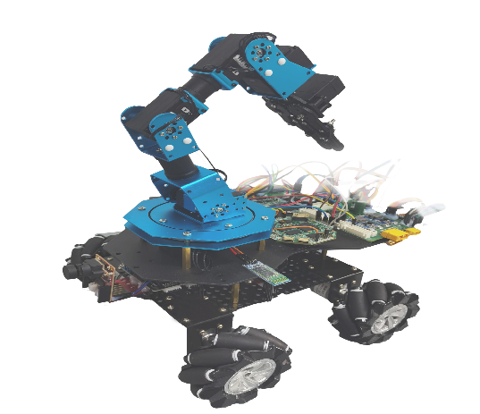
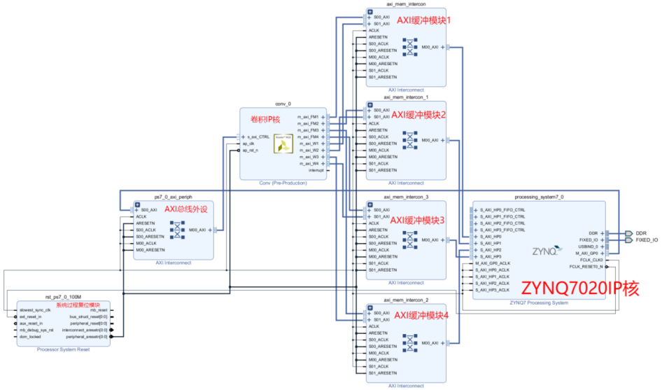
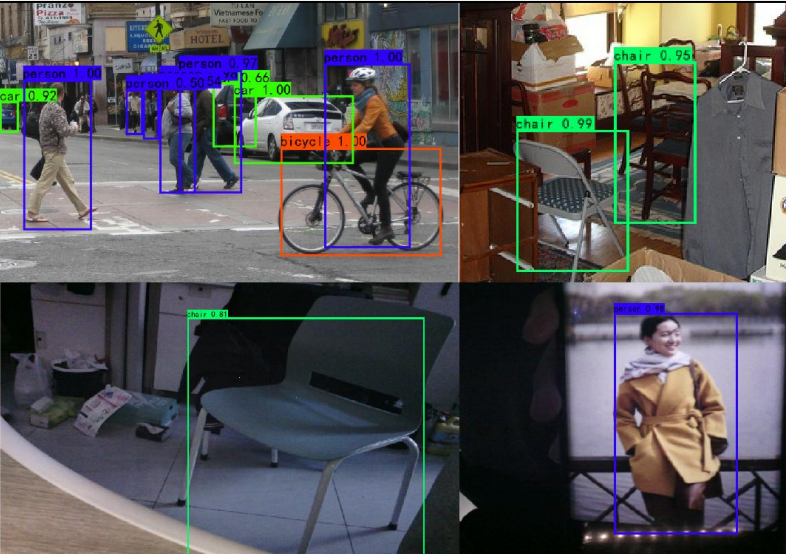

# 面向导盲领航的 YOLO 加速系统

**Blind-Guide YOLO Accelerator — YOLOv4-tiny on AMD Zynq-7020**

2026 年 FPGA 大赛 AMD 自主选题赛道参赛作品（工程代号 CICC5536）。



本项目面向导盲领航机器人对**高效、低功耗环境感知**的需求，在 AMD Xilinx Zynq-7020 上构建
YOLOv4-tiny 目标检测硬件加速系统：以可复用硬件算子、AXI 片上双缓冲和处理器协同调度为核心，
并把超声测距与人体存在雷达接入检测后处理链路，输出目标类别、空间位置、视觉得分与辅助传感
信息，为障碍物描述、语音提示和路径规划提供统一、结构化的感知接口。

验证平台为轮式底盘 + 六自由度舵机机械臂（右侧实物图），底盘由减速电机与麦克纳姆轮组成，
机械臂承载超声、雷达、摄像头与执行机构，用于扫描、抓取与转移演示。

<br clear="right" />

---

## 1. 硬件平台

| 项目 | 说明 |
| --- | --- |
| 目标器件 | AMD Xilinx Zynq-7000 `xc7z020clg400-1`（Zynq-7020，双核 Cortex-A9 + PL） |
| 开发工具 | Vivado 2020.2 + Vitis；部分 RTL 由 Robei EDA 图形化生成后导出 |
| 图像输入 | OV5640 摄像头，采集后经 SD 卡 BMP → BIN 转换送入网络 |
| 辅助传感 | 4 路超声测距（左/右/左前/右前）、人体存在雷达（UART）、DHT11 温湿度、光照传感器 |
| 人机交互 | OLED 显示（I2C）、串口日志、LCD 预览 |
| 执行机构 | 六自由度 PWM 舵机机械臂 + 麦克纳姆轮底盘（减速电机） |

## 2. 关键指标

以下数值取自技术报告中的实测记录与实现报告。**各项统计对象不同，不可跨口径直接换算。**

| 指标 | 数值 | 口径 |
| --- | --- | --- |
| 单次前向计算 | **461.799 ms** | 覆盖前向计算及输出缓存失效，不含图像读取、权重加载 |
| 后处理（解码 + NMS） | **13.512 ms** | 围绕 detector 调用，不含输出写文件与定点转浮点 |
| 合计（局部） | 475.311 ms | 前向占 97.16%，后处理占 2.84% |
| DSP 占用 | **218 / 220** | 系统汇总，剩余 2 个 |
| 芯片功耗估计 | **2.821 W** | 动态 2.635 W + 静态 0.186 W，置信等级 Medium |
| 实现时序 | WNS 0.309 ns / WHS 0.030 ns | 当前工程版本与约束，无失败端点 |
| conv 模块 HLS 估计 | 12.004 ns ≈ 83.31 MHz | 目标 10 ns；仅模块级综合估计，非整机时钟 |

> 461.799 ms 与 13.512 ms 是同一份日志中顺序记录的两个局部区间，不包含摄像头采集、
> 文件转换、显示刷新与机器人动作时间，因此不能等同于端到端延迟，也不能用其倒数当帧率。

**资源占用**（实现后 Summary，对应上图 `04-resources.png`）：

| 资源 | 使用 | 可用 | 占比 |
| --- | ---: | ---: | ---: |
| LUT | 35 278 | 53 200 | 66.31 % |
| LUTRAM | 5 648 | 17 400 | 32.46 % |
| FF | 32 698 | 106 400 | 30.73 % |
| BRAM | 94.50 | 140 | 67.50 % |
| **DSP** | **218** | **220** | **99.09 %** |

## 3. 系统结构



Vivado Block Design：PL 侧为 `conv` 卷积 IP 与 4 组 AXI 缓冲模块（双缓冲交替），
PS 侧为 ZYNQ7 Processing System，两侧通过 AXI Interconnect 与 `ps7_0_axi_periph`
互联，复位由 `rst_ps7_0_100M` 统一管理。

```
        ┌──────────────────── PS (ARM Cortex-A9) ────────────────────┐
        │ 文件读入 / 权重加载 → 网络层调度 → 输出解码 / NMS → 融合得分 │
        └───────────────▲────────────────────────────┬──────────────┘
                        │ AXI 存储与控制接口          │
        ┌───────────────┴────────────────────────────▼──────────────┐
        │                    PL (可编程逻辑)                          │
        │  卷积 / 逐点卷积 / 最大池化 / 上采样 / LeakyReLU 可复用算子   │
        │  片上双缓冲：加载(B) 与计算(A) 交替，掩盖数据搬运             │
        │  UART×5、超声回波捕获、PWM、I2C(OLED/光照)、DHT11            │
        └────────────────────────────────────────────────────────────┘
```

* **PS 侧**：顺序性强的层间控制、参数更新与结果整理。
* **PL 侧**：规则性强的重复乘加与确定时序接口；按 YOLOv4-tiny 层配置归纳为六类可复用算子。
* **融合**：视觉 + 雷达 + 超声在统一归一化后按固定权重合成 `score_final`，与候选框、类别一起输出。

## 4. 目录结构

```
.
├── score_fusion_fixed.v            # 修正版融合得分模块（统一分母定点乘加）
├── score_fusion_fixed_tb.v         # 上述模块的 testbench
├── CICC5536源码验证/                # 原工程按功能分模块的源码归档
│   ├── SYSTEM/                     # ★ 系统顶层，含全部外设与数据通路（推荐从这里读）
│   │   ├── SYSTEM.v                #   顶层模块 SYSTEM
│   │   ├── verilog/                #   源文件集合 + filelist.v / fpgafiles.vf
│   │   ├── constrain/              #   system_constrain.xdc 引脚与时序约束
│   │   └── *.v                     #   Robei 导出的完整模块副本
│   ├── CAR_CONTROL/                # 小车控制：car_top（4 路超声 + PID + 4 轮 PWM + 3 路串口）
│   ├── CAMERA_PID/                 # 摄像头串口 + PID 闭环子集
│   ├── ARM_CONTROL/                # 机械臂串口指令接收（Uart_txd）
│   ├── ENVIRONMENT/                # 环境感知：environment_main + OLED + DHT11 + 光照
│   ├── HEART_OXYGEN_AI/            # 心率血氧 + AI 串口收发（heart_o2_top）
│   ├── LENET_CNN/                  # 独立 Vivado 工程 final_cnn（LeNet 定点推理）
│   └── CONSTRAIN/                  # 约束文件
└── docs/                           # 技术报告 / 答辩 PPT / 演示视频 / 配图
```

各模块目录内部的 `filelist.v`、`fpgafiles.vf` 保留了原开发机上的**绝对路径**
（如 `E:/hls/Robei/eachmodule/...`），移植到自己的机器时需要替换为本地路径，
或直接在 Vivado 中手工添加源文件（见第 6 节）。

## 5. 模块清单

| 子系统 | 主要模块 | 功能 |
| --- | --- | --- |
| 系统顶层 | `SYSTEM` | 汇聚检测结果、串口、超声、OLED、光照、温湿度与机械臂 PWM |
| 超声测距 | `UltraSonicTop_drive`、`UltraSonic_drive` | 触发/回波时序换算 4 方向距离 |
| 摄像头与 PID | `CameraAndPid_drive`、`uart_rx_from_camera`、`pid_controller`、`pid_algorithm`、`pwm_divider` | 摄像头串口帧接收、PID 运算与 PWM 占空比输出 |
| 人体存在雷达 | `uart_rx_heart`、`uart_rx_from_ai`、`heart_o2_top`、`HearAndOxygen` | 雷达/心率血氧串口帧解析与状态判定 |
| AI 链路 | `uart_tx_ai`、`uart_tx_data`、`uart_byte_tx`、`uart_t_top` | 检测结果打包上传与机械臂指令下发 |
| 环境感知 | `environment_main`、`TempAndHumi_drive`、`light_drive`、`IIC_Driver`、`OLED_*` | DHT11 温湿度、光照采集与 OLED 显示 |
| 小车控制 | `car_top` | 4 路超声 + 3 路串口输入 → 4 轮 PWM 输出 |
| CNN 算子 | `Conv2d`、`ConvKernel`、`Max_pool`、`Avg_pool`、`Relu`、`Relu_activation`、`Mult`、`FullConnect` | LeNet 定点推理算子库（`LENET_CNN/final_cnn`） |

## 6. 复现步骤

1. **环境**：安装 Vivado 2020.2，器件 `xc7z020clg400-1`。
2. **建工程**：新建 RTL 工程，顶层设为 `SYSTEM`。
3. **加源码**：把 `CICC5536源码验证/SYSTEM/verilog/*.v` 全部加入 Design Sources
   （`filelist.v`、`fpgafiles.vf` 里的绝对路径需按本机实际情况改写，或忽略它们手工 Add Sources）。
4. **加约束**：加入 `CICC5536源码验证/SYSTEM/constrain/system_constrain.xdc`。
5. **综合实现**：Generate Bitstream → 导出硬件 → 在 Vitis/SDK 中运行检测程序并加载权重与输入 BIN。
6. **仿真**：融合得分模块可直接跑 `score_fusion_fixed_tb.v`；LeNet 工程见
   `LENET_CNN/final_cnn/final_cnn.srcs/sim_1/new/LeNet_test.v`。

## 7. 融合得分与定点实现说明

技术报告原方案为固定权重：视觉 85%、人体存在/活动 5%、超声相关特征合计 10%
（其中尺寸 5%、水平起伏 2.5%、垂直起伏 2.5%），即

```
s = 0.85·s_v + 0.05·s_r + 0.10·s_u
```

历史代码中的比例项写作 `score_v * (31'd5 / 31'd100)` 这类形式。按 Verilog 整数运算语义，
`5/100` 会先被截断为 `0`，权重分支实际失效。根目录的 **`score_fusion_fixed.v`** 给出修正实现：
把所有权重放大到同一分母 200 上做整数乘加再除回，

| 分支 | 原权重 | 修正分子（分母 200） |
| --- | ---: | ---: |
| 视觉得分 `score_yolo` | 0.85 | 170 |
| 人体存在 `score_b` | 0.05 | 10 |
| 超声 `score_v` | 0.05 | 10 |
| 超声 `score_ux` | 0.025 | 5 |
| 超声 `score_uz` | 0.025 | 5 |

要求各输入、输出使用**同一固定点缩放因子**；模块内部以 `SCORE_W+8` 位宽保存中间结果，
避免乘加溢出，最后统一除 200。`score_fusion_fixed_tb.v` 可用于与软件参考值逐项比对。

> 融合得分是**当前规则与数值格式下的计算量**，在缺少带标注数据的统计校准前，
> 不应解释为目标类别的正确概率。报告中的椅子样例（视觉 0.808802 → 融合 0.834520）
> 仅验证算术关系成立。

## 8. 验证结果示例



板上 YOLOv4-tiny 推理输出：`bus 0.76`、`car 0.99`、`bicycle 1.00`、`person 1.00`、
`chair 0.98/0.99` 等。输出包含类别标签、目标框与置信度，经解码与非极大值抑制后送入融合与接口。
由于缺少统一测试集与标注文件，这些样例用于说明输出格式与程序路径，**不用于计算 mAP 等总体指标**。

## 9. 已知限制与后续工作

* 现有验证分别覆盖采集显示、板上推理、ILA 接口波形与机械臂动作，**尚未串联到同一时间轴**，
  缺少连续视频输入到提示/动作的端到端记录。
* DSP 已用到 218/220（99.09%），继续加大并行度的空间很小；优化重点应放在数据复用、
  并行度分配与后处理开销，而不是继续堆乘加单元。
* 融合链路仍需解决**目标关联、类别适用性与定点数值一致性**（例如 chair 样例中出现生物辅助项）。
* 后续计划：统一工程版本重复计时 → 固定测试集统计误检/漏检/类别混淆 → 受控场景下的感知-提示-运动闭环。

## 10. 资料

| 文件 | 说明 |
| --- | --- |
| `docs/技术报告-嵌赛_最终版.docx` | 完整技术报告（设计、实现、验证与指标） |
| `docs/答辩PPT-嵌赛_最终版.pptx` | 答辩演示文稿 |
| `docs/演示视频_第九届2026版.mp4` | 实物演示（机械臂夹持、抬升、转向、释放） |

## 11. 说明

* 仓库内源码由原工程直接归档，仅将文本文件统一转码为 **UTF-8**（原始为 GBK/UTF-8 混合），
  以便在 GitHub 上正常显示中文注释，**未改动任何逻辑**。
* 本项目为参赛作品存档，未附加开源许可证；如需引用或复用，请联系作者。
* 报告中的资源、时序、功耗数据对应特定工程版本与工具版本，修改设计后需重新综合实现核对。
